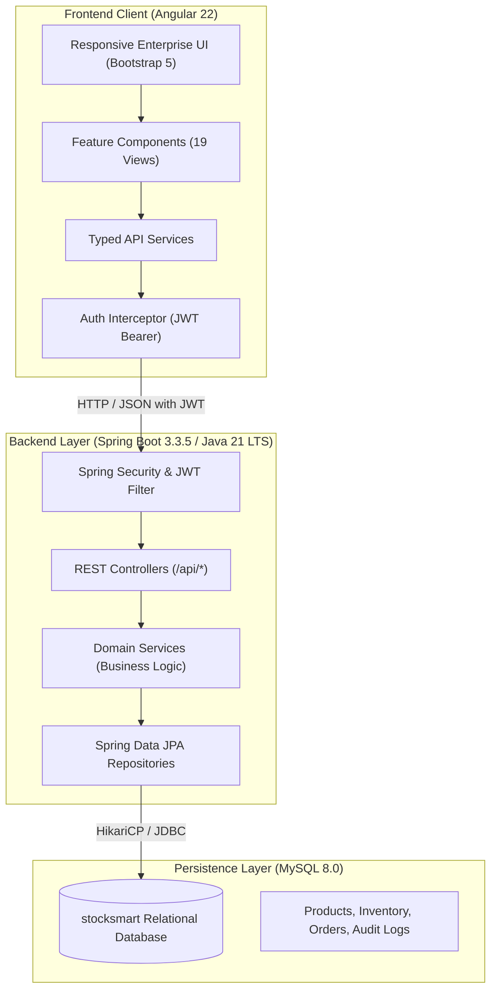
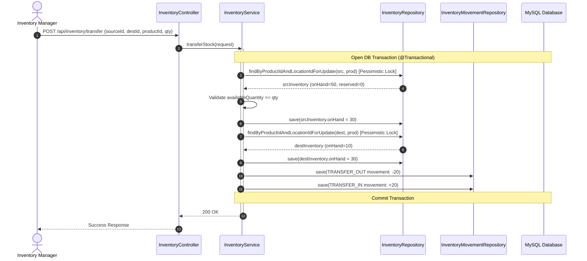

# StockSmart Architecture & System Design

## 1. System Architecture Overview

StockSmart follows a modern, enterprise multi-tiered architecture with strict separation of concerns, transactional integrity, and stateless JWT authentication.

## 2. Inventory Consistency & Atomic Transactions

A central tenet of retail inventory optimization is strict mathematical consistency:
- **Quantity Non-Negativity:** Database constraints (`CHECK (quantity_on_hand >= 0)`) and service-layer validation prevent negative stock under any condition.
- **Pessimistic Concurrency Locking:** The `InventoryRepository` uses `@Lock(LockModeType.PESSIMISTIC_WRITE)` during stock adjustments, transfers, and sales order fulfillment to eliminate race conditions and overselling.
- **Atomic Multi-Location Transfers:** A stock transfer atomically decreases source quantity and increases destination quantity within a single `@Transactional` boundary. If either step fails, the entire transaction is rolled back.
- **Auditable Movement Ledger:** Every change in inventory (RECEIPT, ADJUSTMENT, TRANSFER_IN, TRANSFER_OUT, SALE) produces an immutable record in `inventory_movements` capturing `quantity_before`, `quantity_after`, user ID, and mandatory reason.

## 3. Role-Based Access Control (RBAC)

The system enforces three security roles:
1. **ROLE_ADMIN:** Complete system access, including `/api/users/**` for account provisioning, user deactivation, and system-wide configurations.
2. **ROLE_INVENTORY_MANAGER:** Full operational control over catalog management, purchase order approval, receiving shipments, stock adjustments, and multi-location transfers.
3. **ROLE_STAFF:** Read access to product catalog and inventory lookups; permission to create customer sales orders at point of fulfillment.

## 4. Hardware Integration Architecture (Future Scope)

- **Optical Barcode Scanners:** Implemented. Supports USB HID keyboard wedge emulation and input scanning.
- **RFID Gate Readers:** Architecture design includes an event-driven sidecar consumer (`/api/inventory/rfid-events`) for EPC Gen2 RFID tags, planned for future IoT expansion.
